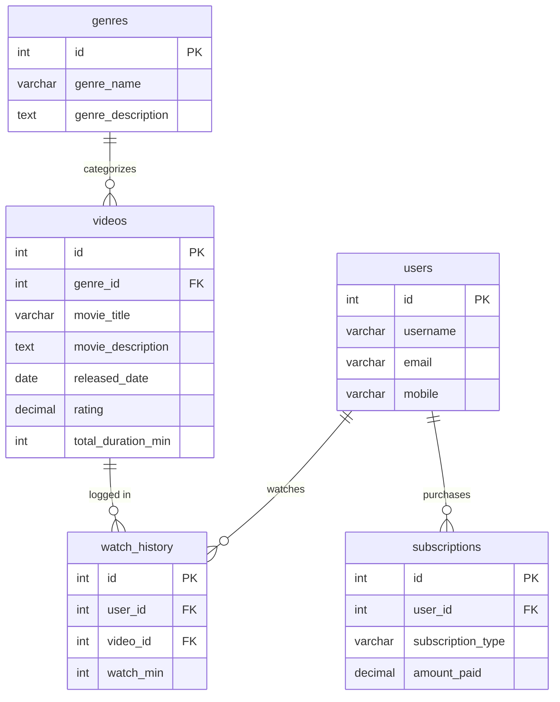

# Netflix Database & SQL Practice Repository

Welcome to the **Netflix SQL Database Clone** repository. This project contains a comprehensive, professionally structured MySQL database schema and query collection modeling a **Netflix-like Video Streaming Platform**.

It demonstrates fundamental to advanced Database Management System (DBMS) concepts—ranging from DDL schema design and DML data seeding to complex table joins, aggregate analytics, regular expressions, and conditional control flow logic.

---

## 📁 Repository Directory Structure

```text
netflix_clone/
├── .gitignore                          # Standard git ignore configuration
├── README.md                           # Project documentation & ER diagram
├── schema/
│   ├── 01_schema_creation.sql          # Data Definition Language (DDL) scripts
│   └── 02_seed_data.sql                # Data Manipulation Language (DML) seed data
├── queries/
│   ├── 03_filtering_and_sorting.sql    # DQL queries, WHERE filtering, LIMIT, OFFSET, ORDER BY
│   ├── 04_aggregations_and_grouping.sql# COUNT, AVG, GROUP BY, HAVING, Duplicate detection
│   ├── 05_pattern_matching_and_conditionals.sql # LIKE, REGEXP, Arithmetic, CASE expressions
│   └── 06_subqueries_and_joins.sql     # INNER/LEFT joins, multi-table joins, subqueries
└── scripts/
    └── setup_all.sql                   # Master setup script (Schema + Seed Data + Queries)
```

### File Details & Key Concepts

| Directory | File Name | Description | Key SQL Concepts Covered |
| :--- | :--- | :--- | :--- |
| `schema/` | [`01_schema_creation.sql`](./schema/01_schema_creation.sql) | Data Definition Language (DDL) | `CREATE TABLE`, `ALTER TABLE`, `MODIFY`, `DROP COLUMN`, `FOREIGN KEY`, `PRIMARY KEY` |
| `schema/` | [`02_seed_data.sql`](./schema/02_seed_data.sql) | Data Manipulation Language (DML) | `INSERT INTO`, `UPDATE`, `DELETE`, `AUTO_INCREMENT` behavior |
| `queries/` | [`03_filtering_and_sorting.sql`](./queries/03_filtering_and_sorting.sql) | Data Querying, Filtering & Pagination | `SELECT`, `WHERE`, `AND`/`OR`/`NOT`, `LIMIT`, `OFFSET`, `ORDER BY` |
| `queries/` | [`04_aggregations_and_grouping.sql`](./queries/04_aggregations_and_grouping.sql) | Aggregations & Duplicate Detection | `COUNT`, `MIN`, `MAX`, `AVG`, `SUM`, `GROUP BY`, `HAVING` |
| `queries/` | [`05_pattern_matching_and_conditionals.sql`](./queries/05_pattern_matching_and_conditionals.sql) | Advanced Matching & Expressions | `LIKE`, `REGEXP`, `CASE WHEN`, Expressions & Arithmetic |
| `queries/` | [`06_subqueries_and_joins.sql`](./queries/06_subqueries_and_joins.sql) | Subqueries & Multi-Table Joins | `INNER JOIN`, `LEFT JOIN`, 4-Table Joins, Scalar/Derived Subqueries |
| `scripts/` | [`setup_all.sql`](./scripts/setup_all.sql) | Master Execution Script | All-in-one database build, data seeding, and query verification |

---

## 🗄️ Database Schema & Entity Relationship Diagram

The database schema models a video streaming platform consisting of 5 interconnected relational tables:



---

## 💡 Key SQL Topics & Queries Covered

### 1. Data Definition Language (DDL)
- **Table Creation**: Primary keys, auto-increment mechanics, nullability constraints, and foreign key cascades.
- **Schema Evolution**: Modifying column data types (`ALTER MODIFY`), adding new metadata attributes (`ALTER ADD`), and dropping unneeded columns (`ALTER DROP`).

### 2. Data Manipulation Language (DML)
- Bulk and single-row insertions into normalized tables.
- Conditional updates (`UPDATE ... WHERE`).
- Record deletion (`DELETE FROM`) and demonstrating MySQL `AUTO_INCREMENT` sequence progression.

### 3. Data Querying & Filtering (DQL)
- Projections, logical search filters (`AND`, `OR`, `NOT`).
- **Pagination**: Offsetting and page retrieval logic using `LIMIT` and `OFFSET`.
- Result ordering with `ORDER BY` (`ASC` and `DESC`).

### 4. Aggregations & Grouping
- Summary metrics: `COUNT()`, `SUM()`, `AVG()`, `MIN()`, `MAX()`.
- Grouping rows using `GROUP BY`.
- Post-aggregation group filtering with `HAVING` (e.g., duplicate record detection, filtering group metric thresholds).

### 5. Pattern Matching & Conditional Control Flow
- Wildcard pattern matching with `LIKE` (`%`, `_`).
- Regular expression validation with `REGEXP` (e.g., verifying 10-digit mobile numbers, filtering email domains).
- Business logic implementation using `CASE WHEN ... THEN ... END` expressions (rating classification, discount calculation).

### 6. Subqueries & Table Joins
- **Subqueries**: `WHERE id NOT IN (...)`, scalar comparative subqueries, and derived table subqueries in `FROM`.
- **Joins**: `INNER JOIN`, `LEFT JOIN`, and 4-table joins connecting `users`, `watch_history`, `videos`, and `genres`.

---

## 🚀 How to Run the Scripts

### Prerequisites
- [MySQL Server](https://dev.mysql.com/downloads/mysql/) (v5.7+ or v8.0+) or MariaDB.
- Any SQL GUI client (MySQL Workbench, DBeaver, TablePlus, phpMyAdmin) or MySQL CLI.

### Quick Setup (Using Master Script)
To build the complete database, insert seed data, and test all queries at once:

```bash
# 1. Access your MySQL CLI
mysql -u root -p

# 2. Execute the master script directly
source /path/to/netflix_clone/scripts/setup_all.sql;
```

### Step-by-Step Setup
Alternatively, execute the individual modular scripts in sequence:

```sql
-- Step 1: Create Database & Schema Tables
SOURCE schema/01_schema_creation.sql;

-- Step 2: Seed Initial Data
SOURCE schema/02_seed_data.sql;

-- Step 3: Run Practice Queries
SOURCE queries/03_filtering_and_sorting.sql;
SOURCE queries/04_aggregations_and_grouping.sql;
SOURCE queries/05_pattern_matching_and_conditionals.sql;
SOURCE queries/06_subqueries_and_joins.sql;
```

---

## 📝 License & Contributions
Contributions, issues, and feature requests are welcome! Feel free to check out the repository, fork it, and give it a ⭐ if you found it helpful.
# netflix-sql-database
